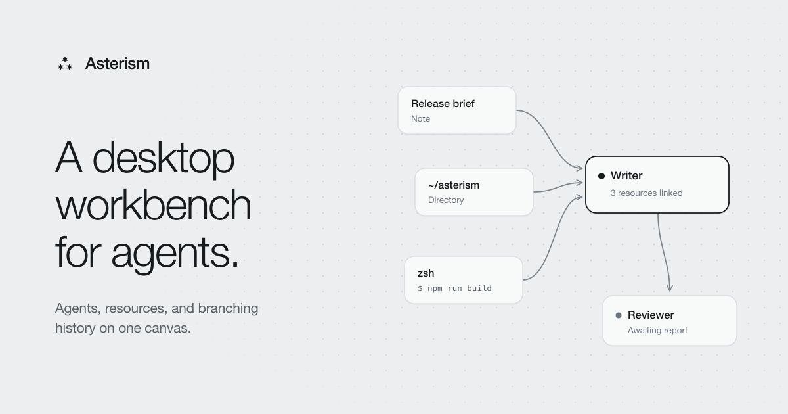

<p align="center">
  <picture>
    <source media="(prefers-color-scheme: dark)" srcset="assets/icon/asterism-dark.svg">
    <source media="(prefers-color-scheme: light)" srcset="assets/icon/asterism.svg">
    
  </picture>
</p>

<h1 align="center">Asterism</h1>

<p align="center">
  A desktop workbench for working with agents.
</p>

<p align="center">
  <a href="https://asterism.dearain.dev">Website</a>
  ·
  <a href="https://github.com/d3ara1n/asterism/releases">Releases</a>
  ·
  <a href="packages/sdk">Plugin SDK</a>
  ·
  <a href="docs/manual/README.md">Manual</a>
  ·
  <a href="LICENSE">MIT License</a>
</p>

<p align="center">
  
</p>

Agents, resources, and work history share one canvas. Place files, notes, terminals, services, and agents into a session, connect explicit directed links to grant each agent access, inspect every operation, and branch work history from any turn.

## How it works

- **Objects on one canvas** — A session keeps a piece of ongoing work together. Agents, files, notes, terminals, and external services live side by side as cards with focused island views for editing, inspection, and conversation.
- **Explicit link authorization** — Directed links decide which resources an agent can see and operate on, and which agents can communicate. Unlinked objects stay out of that agent's context. Each request captures its links and configuration at request start.
- **Branching history tree** — Asterism records session history in SQLite independently of any provider or agent framework. Browse past turns or continue from an earlier point to create a branch while preserving the original path.
- **Paradigms are plugins** — The bundled `asterism.builtin` plugin holds no private host privileges. Resources, tools, workbench views, model presets, and new agent paradigms all load through the same public SDK.

## Built-in capabilities

The official bundled plugin (`@asterism-app/builtin`) ships a complete resource set for single-agent and multi-agent work:

| Category | Resources & features |
| --- | --- |
| **Agents & coordination** | Reusable **Agent** configurations and roles (separate from model connections), multiple independent agents per session, direct agent messaging, cross-session **Mesh** channels, and bounded **Subagent Pools** with task steering and cancellation. |
| **Files & notes** | Real local **Directories** (file tree, search, read, hashline-verified edits, diffs, shell execution) and shared session **Notes**. |
| **Terminals** | Live interactive PTY **Terminals** shared between you and linked agents. |
| **Tasks & schedules** | Cross-session **Todo Lists**, countdown **Timers**, and repeating **Alarms**. |
| **Web & external tools** | **Web** search and URL fetch across configured providers, and **MCP Host** for browsing, searching, and calling configured MCP servers (including OAuth). |
| **External messaging** | **Conversations** and **Chat** bridges for Telegram, Discord, Slack, and QQ. |
| **Knowledge & usage** | Built-in searchable **Manual** resource for models, reusable **Skill** packages, and a local SQLite **Usage** dashboard tracking tokens, timings, and estimated costs. |

## Install

Download the latest stable installer from [GitHub Releases](https://github.com/d3ara1n/asterism/releases):

- **macOS (Apple Silicon)**: [`Asterism-mac-arm64.dmg`](https://github.com/d3ara1n/asterism/releases/latest/download/Asterism-mac-arm64.dmg)
- **Windows (x64)**: [`Asterism-win-x64.exe`](https://github.com/d3ara1n/asterism/releases/latest/download/Asterism-win-x64.exe)
- **Linux (x86_64)**: [`Asterism-linux-x86_64.AppImage`](https://github.com/d3ara1n/asterism/releases/latest/download/Asterism-linux-x86_64.AppImage)

On macOS, drag `Asterism.app` into `/Applications`. Release builds use a fixed self-signed certificate rather than Apple notarization. If Gatekeeper quarantine blocks opening a download whose source you trust:

```bash
xattr -dr com.apple.quarantine /Applications/Asterism.app
```

After launching, configure a model provider in **Settings** (Anthropic, OpenAI, or compatible relays), start a session from **Home**, add resources, and link them to the agents that need them.

## Data, network, and boundaries

- **Local storage** — Sessions, SQLite history, the usage ledger, and application settings live on your machine. No Asterism account or cloud workspace is required.
- **Configured services** — Model requests go directly to the providers you configure. Optional integrations (Web search, MCP servers, external chat platforms) connect only when configured.
- **Updates** — Checking for updates in **Settings** queries GitHub Releases and downloads installers on request.
- **Crash & error reporting (opt-in)** — Builds include Sentry crash reporting, **disabled by default**. When enabled in **Settings → About** (takes effect after restart), Asterism sends sanitized JavaScript error stacks (application frames and generic error types only, excluding user messages and local variables) and native crash minidumps (which can contain data from application memory) to Sentry.
- **Execution boundaries** — Resource links enforce model context and resource-tool authorization; they are not an operating-system sandbox. Shells, terminals, plugins, and MCP servers run with the current OS user's permissions. Branching history switches active session state without rolling back external files on disk.

## Plugins & packages

Asterism publishes its plugin authoring packages under `@asterism-app`:

| Package | Path | Purpose |
| --- | --- | --- |
| `@asterism-app/sdk` | [`packages/sdk`](packages/sdk) | Public contracts, host capabilities, guides, and examples for plugins |
| `@asterism-app/builtin-api` | [`packages/builtin-api`](packages/builtin-api) | Public domain contracts and extensions for the built-in agent paradigm |
| `@asterism-app/plugin-build` | [`packages/plugin-build`](packages/plugin-build) | Standalone artifact builder (`asterism-plugin-build`) for plugin packages |
| `@asterism-app/builtin` | [`packages/builtin`](packages/builtin) | Bundled official plugin *(private workspace)* |
| `@asterism-app/ui` | [`packages/ui`](packages/ui) | Shared UI primitives and workbench components *(private workspace)* |

## Develop locally

Requires Node.js `>= 22.15.0` and npm:

```bash
npm install
npm run dev
```

Useful scripts:

| Command | Description |
| --- | --- |
| `npm run dev` | Build the bundled plugin and start Electron + Vite in development mode |
| `npm run check` | Run TypeScript typechecks, unit tests, and i18n checks |
| `npm run test:plugins` | Run process-backed plugin build and loading integration tests |
| `npm run build` | Build plugins and desktop application bundles |
| `npm run package` | Package unpacked desktop distributables locally without publishing |

Development and installed runs use separate application data directories. Real sessions, snapshots, and credentials stay outside the repository.

## Documentation

- [`docs/manual/`](docs/manual/README.md) — English conceptual manual for users and plugin authors (also exposed inside the app via the built-in **Manual** resource)
- [`docs/development/`](docs/development/README.md) — Internal architecture, runtime, storage, and release documentation
- [`website/`](website/README.md) — Static Astro landing page deployed to [asterism.dearain.dev](https://asterism.dearain.dev)

## License

[MIT](LICENSE)
