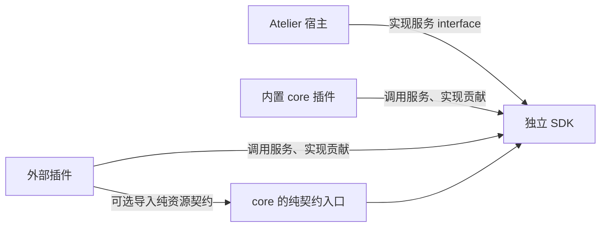
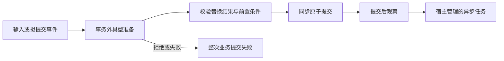

# 插件 SDK 与会话扩展 interface 草案

> 状态：待评审。`draft-*` 用于尚未冻结的设计与声明原型；确定的约定转入 docs，任务完成后草案随计划归档。当前实施范围的唯一真值仍为 [插件计划](todo-2026-10-12-plugin-system.md)。本文细化已确认的独立 SDK、源码开发插件、具型资源和会话扩展方向，不代表接口、存储或依赖已获实施确认。
>
> 配套 [SDK 声明原型](draft-2026-10-12-plugin-sdk.ts)、[core 领域库用例](draft-2026-10-12-core-contracts.ts) 和 [插件作者用例与类型检查](draft-2026-10-12-plugin-examples.ts) 分文件维护依赖方向。它们不是可执行 SDK，也没有实现宿主行为。

## 1. 依赖方向与共识内容

Atelier 与插件共同引用 SDK。SDK 定义服务 interface 和贡献 interface；宿主实现会话、资源访问、模型、任务及装配服务，插件调用服务并实现自己的资源、工具与视图。内置插件与外部插件使用相同 interface。

SDK 不定义 AgentResource、AgentConfiguration、用户消息或命名规则。core 插件持有 Agent、Note、Directory 的知识，并按普通包规则导出自己的领域库。其他插件需要某个领域时显式依赖该库；只使用模型 stream/run 的插件不依赖 core。

插件单向向宿主声明贡献，SDK 不提供读取其他插件实例或任意服务导出的机制。插件作者可以自行抽出 `.core` 或其他普通库共享类型与协议，包名、导出和版本由作者管理。需要运行时协作时，通过独立的具名消息入口通信。



SDK 中的共识包括：

- 契约身份、版本、schema、数据的具型解码和未知记录处理。
- Session、资源实例、记录、路径位置和链接的表达。
- 调用 context 的作用域、有效期、错误、取消与事务约定。
- 插件与模块的贡献声明、装配及版本检查。
- 提交、通知、准备、异步活动之间的顺序与交付保证。
- 模型服务消费的协议中立输入、流事件与结果，工具定义及结果的共享结构。

SDK 提供轻量的声明 helper、schema 校验和类型推导；SQLite、模型 adapter、资源授权、任务调度、React Flow 与 Electron 由宿主实现。不导出宿主注册表、数据库连接或内部具体类作为宿主服务 interface。

插件私有 `db()` 是另一件事：它属于插件便利设施。第一版可沿用已有 node:sqlite 能力并明确 Node 版本支持，不把它误当会话数据库接口，也不同时承诺可替换的通用数据库 abstraction。

## 2. 包与导出

正式 npm scope 和包名待确定，以下用 `<sdk>`、`<core>` 表示。

| 导出 | 内容 | 依赖约束 |
| --- | --- | --- |
| `<sdk>/contracts` | Json、契约引用、资源／记录／命令／工具／展示契约、namespace 与声明 helper | 纯 TypeScript 与现有 Zod；不加载 Node、React、Electron |
| `<sdk>/runtime` | 宿主服务 interface、context、贡献声明、资源与工具实现 helper、观察与准备声明 | 可包含 Node 类型与便利设施，不加载宿主实现或 React |
| `<sdk>/renderer` | renderer 贡献、具型卡片／工具渲染 helper、宿主 UI context | React peer，由宿主提供同一 React 实例；不加载 runtime |
| `<core>/contracts` | Agent、Note、Directory 及其记录、命令和展示契约 | 只引用纯契约入口 |
| 插件包的 `/runtime`、`/renderer` | 对应进程的贡献入口 | 分别引用 SDK 对应入口 |

推荐在当前仓库新增 `packages/plugin-sdk/` 与 `packages/core/`，应用暂保留现有根目录，避免为了包组织搬动全部桌面工程。core 的领域知识可用 `/contracts` 等普通 export 提供，也可抽成单独的领域库，不注册到 SDK 的知识目录。SDK 各入口生成 JS 与 `.d.ts`，`exports` 指向包内产物；不能用转发应用 `src/` 的方式伪装成独立包。

SDK 版本与宿主支持版本独立。插件声明 `{ major, minMinor }` 所需 interface 版本；宿主在执行模块工厂前验证。初期按 major 不同拒绝、同 major 的宿主 minor 不小于所需值接受。API 格式发布后，兼容性由接口约定承担，不由函数存在或 TypeScript 类型相同推断。

插件版本、SDK 版本、资源／记录／展示格式版本分别管理。SDK 小版本不能自动代表历史数据可解码。

### 2.1 第一版公开 interface 清单

| Interface | 作者侧能力 | 宿主实现承担 |
| --- | --- | --- |
| `PluginContext` | id、dir、log、config、secrets、插件私有 db、模型服务、只读目录 | 身份注入、设施托管、故障诊断与关闭 |
| `PluginConfig<T>` | get、set，数据由 schema 与 defaults 确定 | 原子保存、默认值、命名空间与校验 |
| `PluginSecrets` | get、set、delete | 复用 vault，保护凭据，稳定不可用错误 |
| `ModelServices` | stream、run、文本便利入口与公开模型解析 | 当前配置、凭据、协议 adapter、超时与流终态 |
| `SessionHandle` | snapshot、受控元数据更新；由调用 context 绑定 | 会话存在性、修订、来源与有效期 |
| `SessionSnapshot` | 固定路径、标题、records、resources | 统一历史投影与查询，不暴露 SessionTree |
| `SessionRecords` | 按导入的记录契约 first、query | 固定范围的查询与分页 |
| `SessionResources` | 按导入的资源契约 get、list | 固定路径的资源实例查询 |
| `ResourceContext<R>` | 绑定实例、读私有数据、同步具型 commit、资源活动 | 归属、事务、活动、写入有效期与 settled |
| `ObserveContext` | 已提交事件、绑定 handle、派生 tasks | 顺序、预算、失败隔离与异步工作承接 |
| `PrepareContext` | 准备所依据的 snapshot 和 signal | 前置条件、最终重验及整个业务提交的拒绝 |
| `TaskContext` | signal、绑定的元数据服务、模型服务 | 去重、并发、取消、超时与迟到结果 |
| `RendererContext` | 具型命令、订阅、公共 UI 服务 | 受控 IPC、来源校验、渲染数据与宿主 React |
| `MessageServices` | post 到已声明的具名入口 | 路由、schema／版本校验、有界投递与错误 |

这是一版服务清单，不要求一个 context 暴露所有服务。prepare 只给读视图和决定接口，元数据 task 不给历史 writer，资源活动的 writer 由绑定实例的 context 提供。工厂得到插件级设施；每次调用得到独立的会话／对象／请求 context。

目录中模型与角色是模型服务的公共类型。现有 `registry.agents()` 含 Agent 专用配置，抽包时迁回 core 的配置消费面，不进入 SDK。需要这些知识的消费者使用 core 作者提供的普通领域库；不新增宿主领域服务目录来间接保留 AgentConfiguration。

SDK 稳定错误建议统一为 `PluginApiError`，至少区分 invalid_argument、not_found、foreign_resource、foreign_event、permission_denied、conflict、stale_context、unsupported_version、unavailable、cancelled、timeout。message 是正式英文诊断，code 用于分支判断；模型角色与模型不存在等错误另带受控 reason。错误不透传 provider 配置、正文或原始 SDK 异常对象。

公开 SDK 的实际声明必须闭合：上表涉及的参数、返回值和辅助类型都由 SDK 或已声明的公共依赖导出。声明原型验证契约、查询、观察／准备、元数据任务、命令和具名消息的关键类型，并演示 stream/run 不依赖任何 core 类型；没有模拟完整模型流、renderer 或数据库实现。

## 3. 作者侧声明形态

保留函数组合和 module 工厂，但工厂返回声明式贡献。观察、准备、资源与工具都进入两阶段装配；不在工厂中启动网络请求、进程或临时注册监听。

```ts
const naming = pluginNamespace("example.naming");

export default definePlugin({
  namespace: naming,
  version: "0.1.0",
  api: { major: 1, minMinor: 0 },
  modules: [defineModule(plugin => ({
    contributions: [
      observe({
        id: "name-session",
        on: Session.Committed,
        run(event, context) { /* 观察并派生任务 */ },
      }),
    ],
  }))],
});
```

贡献短名按插件身份补全；宿主保留贡献归属和工厂装配清单。模块失败时丢弃整组贡献，关闭已创建的托管设施，不留下生效订阅。不同模块同名贡献为装配错误，不靠注册时机抢占。

资源控制器可以内部使用 class。SDK 使用结构化 interface 和具型契约值，不要求继承一棵插件基类，也不依赖模块全局单例。

## 4. 契约值、schema 与跨包识别

### 4.1 资源关联独立记录与命令契约

```ts
const core = pluginNamespace("atelier.core");

const UserMessage = core.record("agent.user-message", {
  version: 1,
  admission: "intent",
  schema: z.strictObject({ text: z.string() }),
});

const TextBlock = core.record("agent.text", {
  version: 1,
  admission: "fact",
  schema: z.strictObject({ text: z.string(), complete: z.boolean() }),
});

const Submit = core.command("agent.submit", {
  version: 1,
  input: z.strictObject({ text: z.string(), submissionId: z.string() }),
  output: z.strictObject({ accepted: z.boolean() }),
});

export const AgentResource = core.resource("agent", {
  version: 1,
  dataSchema: z.strictObject({}),
  createSchema: z.strictObject({ configuration: z.string() }),
  records: { UserMessage, TextBlock },
  commands: { Submit },
});
```

这是最小示例。真实 Agent 的记录需要保留 responseId、ordinal、requestParentId、协议续接资料、完整性与工具结局；这些属于 Agent 的记录契约，不能为了 SDK 简化而丢失。现有 `Agent.stateSchema` 只描述创建时的公开数据，不能用于推导消息、卡片数据或全部私有状态。

资源公开数据、创建输入、私有状态、记录和卡片投影采用不同契约。私有状态可用具型 `PrivateDataContract<T>` 按键管理，并只在绑定资源的提交事务内修改；笔记当前内容仍遵守未捕获、不产生正文历史的约定。

### 4.2 运行时识别

作者调用时传入契约值，TypeScript 从该值推导泛型。SDK 多副本不影响识别：按稳定契约身份、支持版本和 schema 解码，不使用 `instanceof`、局部 Symbol 或对象引用相等。

namespace helper 将字面量短名保留为类型参数。`writer.append(contract, data)` 的 payload 使用 `NoInfer`，防止从错误 payload 反向扩大契约泛型。相同数据形状的两个记录也保留不同契约身份。

同一身份和版本由契约作者保证语义一致。装配可以检查可比较的声明内容，发现冲突就拒绝该插件；schema 相同不证明语义相同，无法自动推断两个任意验证函数等价。

工具仍保留全局模型名称、description、guidelines 与 args，资源实现继续声明 target/result、读写副作用和并发策略。独立包下的共享工具契约需补稳定引用：共享按引用识别，名称覆盖仍按既定插件顺序解析。现有按对象引用认定共享的规则需迁移，具体引用与版本结构在实施前确定。

## 5. 会话记录信封与具型视图

公开信封以宿主树信息和契约引用组织：

```ts
interface SessionRecord {
  readonly id: string;
  readonly sessionId: string;
  readonly parentId: string | null;
  readonly sequence: number;
  readonly createdAt: string;
  readonly contract: ContractRef;
  readonly resource: ResourceRef | null;
  readonly data: Immutable<Json>;
}
```

`resource` 表示记录的关联对象。它不预设作者、接收者或执行者；具体含义由记录契约说明。宿主会话事件可无关联对象，来源插件与贡献由宿主 context 记录，不能由 payload 自报。

`SessionSnapshot` 是固定位置的只读视图，`SessionHandle` 是绑定某个会话的服务句柄。具型操作直接面向记录或资源集合：

```ts
interface SessionSnapshot {
  readonly id: string;
  readonly position: { nodeId: string | null; sequence: number };
  readonly title: TitleSnapshot;
  readonly records: SessionRecords;
  readonly resources: SessionResources;
}

interface SessionHandle {
  readonly id: string;
  snapshot(position?: { nodeId: string | null }): Promise<SessionSnapshot>;
  readonly title: {
    propose(text: string, options: {
      expectedVersion: number;
      cause: RecordRef;
    }): Promise<"applied" | "superseded" | "conflict">;
  };
}
```

观察事件直接携带该次提交的 snapshot；事件返回后它仍保持原位置。任务要读取最新状态时，显式使用 handle 再取 snapshot。GUI 的查看位置不作为后台插件的隐式当前会话。

| 操作 | 语义 |
| --- | --- |
| `UserMessage.decode(raw)` | 导入的领域记录契约负责纯解码，不查询宿主 |
| `snapshot.records.first(UserMessage, query)` | 取得最早匹配记录；不能解码时返回 unknown，不跳过后取 |
| `snapshot.records.query(UserMessage, query)` | 分页消费具型记录 |
| `snapshot.resources.get(AgentResource, id)` | 按资源契约查询快照中的实例与公开数据 |
| `snapshot.resources.list(AgentResource)` | 按资源契约列出快照中的实例 |

query 显式选择 `scope: "path" | "session"`，可限制 objectId、after 和 limit。path 是该 snapshot 的祖先路径；session 是截至其 sequence 的真实追加记录。资源集合针对固定路径投影，已移除资源的历史记录仍保留其发生时的关联身份。资源公开数据与私有状态、卡片投影不同，不把资源查询视为读取外部文件或恢复历史内容。

解码结果为 `null`（不匹配）、`known`（具型数据）或 `unknown`（版本不支持／数据无效并保留原始信封）。SDK 只实现身份、版本与 schema 的通用解码规则，UserMessage 的字段、用途与首条判定属于领域。缺失资源实现和记录无法解码分别表达：消费方持有纯契约时，即使来源插件未启用，也能解读已保存记录。

SDK 不提供用户消息专用索引。命名插件通过 core 用户消息契约在全会话记录中查询最早接受的匹配记录，按真实追加序号确定稳定身份，不随分支或代理重置。更广泛的跨资源消息语义由相应领域库定义，SDK 不从字段名或资源名称猜测。

## 6. 资源实例、命令、工具与写入

具型资源契约由后台贡献实现。创建、命令、project、inspect、环境来源仍分别处理；handler 输入与输出由契约推导，业务授权由宿主执行层与资源控制器实施，不因导入契约而获得能力。

推荐把当前 `implementResource` 与 `implement` helper 移入 SDK，再以具型命令表替换资源控制器里手工解析 command 的写法。命令表的键、input/output 和实例 context 从资源契约推导：

```ts
implementResource(AgentResource, {
  commands: {
    async Submit(input, context) {
      // input 来自 Submit.input；context 已绑定当前实例和调用来源。
      // 异步准备完成后使用同步 context.commit，资源活动单独启动。
      return { accepted: true };
    },
  },
});
```

命令契约包含 input/output；宿主从命令表生成带契约身份的注册项，校验命令属于目标资源、路由匹配的 handler 并校验返回值。`accepted` 只表示提交被受理，不代表模型已完成。通用快照查询是只读操作，不通过取得资源数据自动发出命令。

resource.create 的输入由 createSchema 定义，异步准备可以产生实现私有的 prepared value；同步创建提交公开数据和私有状态。prepared value 不持久化，也不是公共历史格式。创建组合需要由宿主提交协调，而不是插件在异步准备期间先创建一半对象。

`ResourceContext<R>` 绑定到会话与实例，只能写本插件、该资源声明的记录和私有状态：

```ts
resource.commit(writer => {
  writer.append(AgentResource.records.UserMessage, { text });
  writer.set(SelectionData, selection);
});
```

writer 不接收任意 NewNode，不由插件填写父指针、节点身份或来源。宿主验证资源仍在正确路径上，检查记录与状态的归属并原子提交。共享读取契约不等于可以伪造其他插件记录。

同步 commit 保留普通同步返回值，用条件类型拒绝 Promise 返回值；运行时也检查 thenable，检查失败回滚。writer 随回调结束失效，迟到写入返回稳定错误。配套原型验证了同步节点引用返回与 async 回调拒绝，但类型检查不能代替运行时有效期控制。

会写历史的异步资源活动使用独立活动句柄；宿主登记对象活动并参与 settled，结束前仍负责提交最终事实。纯标题任务不提供历史 writer，也不使会话等待它才能回溯。活动、工具执行与元数据任务的具体共享实现可以复用宿主任务管理，公开 context 保留各自能力范围。

工具 schema、动态产出、终结模型投影和渲染器沿用已有契约；SDK 不把 resource_call 一级入口开放为插件贡献，也不把当前私有状态自动变成可恢复快照。

## 7. 提交后观察

推荐第一批稳定的 Session 事件：

| 契约值 | 触发边界 |
| --- | --- |
| `Session.Created` | 新会话及其首批记录最外层事务成功后 |
| `Session.Committed` | 一次业务事务提交记录或终态追加元数据后 |
| `Session.CursorChanged` | 执行路径改变；单纯 GUI 查看不触发 |
| `Session.MetadataChanged` | 标题等元数据真正改变后 |
| `Session.Closing` | 宿主退出或会话删除前清理；不是关闭卡片或切页面 |

插件级启动与关闭用于托管进程／watcher 的建立和幂等清理，资源活动也可以单独通知；具体 interface 随消费者补充，不先开放所有模型流增量。

`Committed` 提供 commitId、snapshot、records 与 completions。终态追加元数据单列，不能被误认成第二次追加同一正文块。Created 在首次 Committed 前派发；首次事务的记录集中在一个批次，回滚不发送任何事件。

宿主在所有写入路径收集提交批次，包括工作台直接树写入、控制器 append 和终态 metadata。最外层提交后入队；插件处理器在事务外执行。派发顺序按真实提交顺序，处理器按插件顺序与贡献顺序快照；处理中产生的新事务进入后续队列，不同步递归派发。

观察结果不改写历史。宿主捕获错误，记录插件、贡献、会话、提交身份与结构化原因；不记录完整正文或凭据。第一版建议处理器默认预算 1 秒，长工作交给 tasks；预算参数属于实施细节。超时使该次 context 失效，继续派发其他处理器，无法强制中止阻塞同进程事件循环的代码。

第一版承诺进程内通知，不承诺重启重放。进度可合并，Committed 不当作可丢弃进度；若积压超过容量，暂停该观察贡献并记录通知缺口，要求显式重新查询／恢复，不继续宣称完整交付。容量与诊断由宿主实现隐藏。

## 8. 进入前准备／拦截

可干预记录契约声明 `admission: "intent"`；已经发生的输出与工具结局声明 `fact`。具型 prepare 只接受 intent：

```ts
prepare({
  id: "check-input",
  on: AgentResource.records.UserMessage,
  run(proposal, context) {
    if (!proposal.data.text.trim()) {
      return { action: "reject", code: "empty_input", message: "Enter a message." };
    }
    return { action: "accept" };
  },
});
```

结果为 accept、replace(data) 或 reject(code,message)。replace 保留原记录契约与关联对象；对象身份、来源、父指针、响应身份不能被通用拦截器改写。替换后由宿主重新校验，后一处理器看到前一处理器的接受值。

执行流程：



首发的 prepare 在创建事务之前执行，使用拟创建对象的类型和预先分配的稳定身份；它拿不到已创建的真实资源，不能在这里产生副作用。已有会话的异步 prepare 完成后重验路径和相关数据版本，变化时返回 conflict，不隐式重跑有外部副作用的处理器。

reject、校验失败、超时与处理器异常均阻止相关业务提交，包括资源创建、消息、私有状态和提交去重状态。不能只跳过 append，然后继续启动执行。

推荐保留原始输入与最终接受值及处理器来源，原始输入作为接受审计，最终接受值作为模型消费的消息；这涉及新增审计格式，需拍板。命名依据进入会话的首条接受消息。若要以原始输入命名，需明确改变消费依据。

事实只能如实记录。工具执行前阻断、模型上下文改写与 UI 转换分别在相应 seam 定义；不能靠拒绝保存结局来撤销已发生的工具副作用，也不能改变签名推理块后仍声称保留合法续接资料。

## 9. 异步任务、标题与模型服务

### 9.1 会话元数据任务

观察 context 提供绑定插件、贡献与会话的 tasks：

```ts
context.tasks.start({
  key: message.id,
  timeoutMs: 30_000,
  async run(task) {
    const result = await task.models.generateText({
      target: { role: "utility" },
      system: "Generate a concise title. Return only the title.",
      input: message.data.text,
      signal: task.signal,
    });
    return task.session.title.propose(result.text, {
      expectedVersion: snapshot.title.version,
      cause: message,
    });
  },
});
```

其中 message 由命名插件调用 `snapshot.records.first(UserMessage, { scope: "session" })` 取得，并确认其属于本次提交。UserMessage 来自 core 领域库；查询最早用户消息的规则属于命名消费方，SDK 不提供 firstMessage 字段。

handle 提供 id、cancel 和 `result: Promise<TaskOutcome<T>>`；失败以结果对象表达，并由宿主诊断，不产生无人消费的 Promise rejection。第一版 key 在当前插件／贡献／会话／宿主运行期去重，完成后重用结果；失败重试必须明确发起，不自动重复模型请求。

任务使用独立 context。观察处理器结束不会取消已经受理的任务，切换页面不取消；宿主关闭或会话删除时取消。任务超时后 title 等服务拒绝迟到写入。默认任务并发建议为每贡献每会话 1，跨会话采用全局有界并发；调度实现不进入作者侧 interface。

纯元数据任务不参与历史收束。第一版不实现可靠跨重启作业队列；可靠补做需要额外确定会话级任务状态、结果去重与外部调用的未知结局。

### 9.2 标题更新

title 具有 text、独立 version 和 source（provisional／automatic／user），与消息序号、游标、布局修订分开。`propose` 是自动标题提议：检查 cause 属于该会话、当前标题版本仍匹配，并且用户未设置标题。实际来源插件由宿主填写。

结果 applied 表示保存并通知；superseded 表示用户标题或已有结果具有优先权；conflict 表示取用后标题已变化。多个命名插件同时工作时，首个符合条件的提议成功，其他提议不会覆盖它。手动改名由宿主用户命令设置 user 来源。

这需要扩展会话元数据，第一版可单独保存，不改写会话树。其存储位置与标题来源的产品语义需拍板。

### 9.3 模型服务的公开 interface

保留 `models.stream` 与 `models.run`，但它们只引用 SDK 的模型协议类型和通用工具执行 interface。模型的输入、输出、工具请求与必要续接资料属于模型协议，不属于 Agent 资源知识。`models.run` 仍为无状态循环；调用方每请求提供 system、messages 和执行能力，消费带 requestId 的流与工具结果。接口不接收 agentId、SessionNode 或 AgentCapabilities，也不为调用方追加领域记录。

core 的 Agent 控制器将这些模型事件映射成自己的 message/block/notice 和选择状态。其他插件可以只引用 SDK，用内存或自己的记录承接 stream/run，不安装、加载或导入 core。固定资源入口、工具批次收束、未知结局与冻结授权仍由对应宿主执行机制保证；声明原型中的 Json 工具结果仅演示形态，正式接口继续采用完整 ToolOutcome。

公开模型解析只返回模型表达式、能力与思考选择，不返回 settings、provider 配置、凭据或具体 adapter。宿主内部继续完成配置与凭据解析，并固定本次请求的环境。

`generateText` 是无资源工具、无会话持久化的文本便利入口，可通过 stream 收集并校验正常终态，服务命名等消费者。用量未知保留 null，失败返回稳定错误；不调用 provider 云端会话或隐式重试。

当前 ModelTarget 只有 role、model、thinking。标题的模型继承建议通过独立 `fallback?: ModelSelection` 表达：显式覆盖优先，其次角色配置，最后采用来源对话的 fallback；它不是 model 覆盖，不能把 utility 已配置的模型强行替换为代理模型。该字段与现有角色继承语义衔接，具体消费接口需确认。未提供 fallback 且 utility 没有模型时明确失败。

工具访问仍须由宿主在请求边界按资源链接与策略取得 `ResourceToolAccess`，调用在执行层复查身份和冻结授权。插件不能用导入一个资源契约或手构造访问对象代替授权。

### 9.4 跨插件调用

不提供 post／receive 具名消息。跨插件协作统一使用资源命令契约：协议方在自己的普通库中导出 command 契约，调用方经 `commands.invoke(Contract, target, input)` 调用，宿主负责路由、输入输出 schema 校验与稳定错误码。返回即表示命令完成；长时工作由被调方转为自己的托管任务，再以记录或命令结果表达进度。

调用不取得对方插件实例，也不自动成为会话历史；需要留痕时由被调资源在自己的提交中产生事件。导入协议库只获得类型与 schema，不启用对方插件。

## 10. Renderer interface

renderer 独立导出 defineRendererPlugin、资源展示描述、cardRenderer、toolRenderer 与具型 Props。卡片／工具 helper 按保存的契约版本验证数据；Body、Actions、headerRenderer、bodyRenderer 沿用现有拆分和默认回退。

renderer 与 runtime 只共享纯契约。宿主注入受控的命令和查询 context，renderer 不拿 Node、会话数据库或 model adapter。资源命令的输入由 SDK command 契约推导，宿主仍通过 IPC 校验并路由。

源码和 npm 包使用同一 renderer 贡献形式。宿主维护固定的共享模块白名单：`react`、`react/jsx-runtime`、`react-dom`、`react-dom/client`、SDK renderer 入口及可选的公开控件入口；白名单之外的依赖一律打进插件 bundle，不同插件可用同一库的不同版本。打包时拒绝未声明的跨插件值导入，知识共享仍经普通库。

- **视图插槽**：卡片、记录渲染、工具结果视图按契约 id 注册为类型化插槽；每个插槽包独立 error boundary，插件视图崩溃只影响自身。
- **静态资源**：wasm、图片、音频等由打包器产出文件，经 `atelier-plugin://<pluginId>/` 协议从插件产物目录提供，不 base64 内联。
- **样式**：插件 CSS 随自身 bundle 加载，以 CSS layer 或前缀约束作用域，不污染宿主 token。
- **按需加载**：开启代码分割，重模块在视图打开时加载。
- **对象二进制流**：高频数据（如模拟器画面、音频）经按对象建立的二进制通道从 runtime 推送到视图，不进入记录、事件或 JSON 信封；持久事实只存引用。状态归 runtime，视图只显示并以资源命令回传输入，因此 agent 与用户共用同一组命令，卡片关闭不影响工具。

## 11. 源码加载与插件管理

插件只有一种：包。`package.json` 的 Atelier 清单字段声明插件 id、SDK API 范围与 `/contracts`、`/runtime`、可选 `/renderer` 入口；源码与发布产物读同一份清单。正式字段名待实施时确定。

来源只决定包在哪里：npm 安装目录或用户添加的本地包路径。来源 adapter 只给出包根，此后清单解析、版本校验、编译、装配、启用／禁用和插件页展示走同一流程，不按来源分支。

- **添加的是包，不是目录**：路径必须是含合法 Atelier 清单的包根，否则添加失败并说明缺失字段；不向下搜索子目录。已添加的包之后失效（路径消失、清单损坏）时显示为无效条目，可移除。
- **添加与启用分离**：管理状态为包列表加每项启用标记，两种来源相同；添加、启用、禁用、升级均重启后生效。
- 包可位于用户 monorepo 的 workspace 中，也可在任意位置；打开某个仓库不会添加或启用其中的包。

启动装配流程：

1. 读取包列表与启用标记，经来源 adapter 定位包根。
2. 校验清单、SDK API 范围与插件 id 冲突（同 id 出现两个来源时报冲突，不静默择一）。
3. 用 esbuild 打包 runtime 与 renderer 入口：共享模块白名单标为 external 并解析到宿主副本，其余依赖从包目录解析并打进 bundle；输出 sourcemap。
4. 产物写入应用数据目录缓存，键为源码、lockfile、宿主 SDK 与编译器版本的哈希；内容不变不重编。
5. 加载 runtime 入口并收集贡献，参与统一两阶段装配后冻结注册表。
6. 向 renderer 发布已验证的视图清单，经 `atelier-plugin://` 取得 bundle 与资源。
7. 编译或激活失败的插件仅在本次运行禁用，插件页显示原因与源码位置，其余插件照常加载。

宿主编译只剥离类型，不做类型检查；类型检查由作者在自己的仓库运行。后台原生 addon 无法打包，只能 external 并按 Electron ABI 自行编译，首批不处理。

调试：sourcemap 映射错误栈；renderer 用 DevTools，runtime 由开发开关以 `--inspect` 启动。不监听文件、不做热重载，改动后重启。

npm 插件版本精确锁定并保留完整性；本地包不伪造版本，插件页显示路径与本次产物标识。esbuild 随应用发布，其平台二进制需从 asar 解出，Forge 打包配置待实施时验证。

首批不提供创建模板，不发布 SDK 到 npm；SDK 以仓库内 workspace 包存在，内置插件与本地包共同引用。

## 12. 现有代码的实施映射

| 现有位置 | 第一阶段处理 |
| --- | --- |
| `src/shared/plugin.ts`、`module-contract.ts`、`presentation.ts` | 抽出 SDK 纯契约；资源记录与命令声明作具型增量 |
| `src/plugins/contract.ts` | 分离 SDK interface 与宿主实现类型，绑定 context 与错误体系 |
| `src/plugins/models.ts` | 保留宿主配置／adapter 解析，公开 interface 不返回内部实现 |
| `src/resources/contract.ts`、`tools/contract.ts` | 作者 helper 与后台贡献 interface 入 SDK；注册目录、授权和执行留宿主 |
| `src/renderer/modules/registry.ts` | 具型作者 helper 入 renderer 入口，宿主 registry 留应用 |
| `src/modules/*/contract.ts` | 内置插件纯契约，作为外部可导入的资源定义 |
| `src/session/projection.ts` | Agent 投影回到 core；SDK 只消费模型协议输入，宿主当前格式映射留在内部 |
| `src/runtime/sessions.ts`、`workbench.ts` | 统一收集最外层提交批次、固定 snapshot、派发通知，提供元数据服务 |
| `src/plugins/loader.ts` | 增加声明式观察／准备贡献与来源 adapter；保持失败原子性 |

第一阶段公开信封通过固定的 legacy adapter 映射当前格式：message → UserMessage，thinking/text/toolcall → core 对应事实契约，资源事件 → 通用会话记录。资源类型从发生时的创建记录定位。映射由当前存储格式和明确的契约版本表决定，不从最新版 schema 猜测旧记录。

第三方资源新增记录可先经既有插件 event 载荷保存 `{recordContract, resource, data}`，具型 writer 完成归属校验并由 adapter 展开；现有物理节点、响应投影与终态规则继续由宿主处理。这是实施建议，仍需明确该载荷版本与选择／继续语义。

完整通用记录存储、agentId 泛化和未知资源的恢复能力属于另一阶段。不能因有了公开信封就宣称所有自定义记录都自动支持模型续接或历史恢复。

## 13. 交付顺序与验证

1. **冻结 interface 与作者用例。** 确认公开信封映射、契约身份、观察／准备语义及标题条件；使用声明原型验证类型推导。
2. **SDK 包可独立消费。** 抽纯契约、runtime／renderer interface 和作者 helper；应用与 core 共同引用，产物无应用私有 import。包内容检查与隔离消费工程验证，不发布 registry。
3. **具型会话读取。** 实现 SessionSnapshot、SessionRecords、SessionResources 和现有格式 adapter；覆盖同形不同身份、版本不支持、实现缺席、已移除资源、分支与长历史分页。
4. **提交后观察、任务与命名。** 统一提交批次，加入短处理器派发、元数据任务和标题 CAS；同时完成仅含 runtime 的最小源码编译与装配，用外部源码命名插件验证消费链路。
5. **进入前准备。** 实现 intent 输入流水线、最终校验、全事务拒绝与变更审计；验证异步准备期间路径变化、异常／超时及首次创建不留下半个会话。
6. **源码与 npm 加载、renderer 和管理页。** 依赖解析、编译缓存、共享 React 与清单装配；验证内置和外部插件消费同一 SDK、源码在仓库外、包缺失／构建失败与重启生效。

验证使用现有类型检查、Vitest 和隔离数据。记录与提交测试从真实业务事务观察，不为 SDK 另造模拟运行时；模型用合成 adapter，取消与晚到结果在任务／元数据 seam 验证。GUI、真实模型与各平台加载由用户验收，不自动启动并杀掉桌面程序。

声明原型命令：

```sh
./node_modules/.bin/tsc --ignoreConfig --noEmit --strict --skipLibCheck --target ES2023 --module NodeNext --moduleResolution NodeNext --allowImportingTsExtensions plans/draft-2026-10-12-plugin-examples.ts
```

该检查验证：正向字段推导、只读解码、错误 payload、同形不同身份、跨资源 writer、资源数据字段、字符串事件名拒绝、fact 拦截、错误替换值、同步事务返回、异步事务拒绝、命令返回值和具名消息误用，并演示只使用 SDK 的 stream/run 调用。它不验证 schema 运行行为、事务、事件交付、任务取消、消息路由、源码编译或 GUI。

## 14. 实施前需要确认的选择

已确认：

- 插件加载、卸载只在重启时生效，注册表进程内冻结。
- 只有一种插件（包），来源只决定位置；添加包与启用分离；添加非包路径即失败，不扫描目录。
- esbuild 统一编译 runtime 与 renderer，不引入 jiti；共享模块白名单外的依赖打进插件 bundle，禁止未声明的跨插件值导入。
- renderer 采用类型化视图插槽与逐槽 error boundary；静态资源经 `atelier-plugin://` 提供；新增按对象的二进制流通道。
- 跨插件协作统一用命令契约，删除 post／receive。
- prepare 挂在命令输入上，不进首批；托管任务仅本次运行有效，需要补做的插件在启动时自行检查，靠 title 版本比较防重复。
- 第一阶段公开信封经 adapter 映射现有格式，不改存储。
- 首批无模板、不发布 SDK。

待定：

- title 来源（provisional／automatic／user）、手动优先及多插件竞争规则。
- 清单字段名、SDK 包名，二进制通道与插槽的具体接口。

